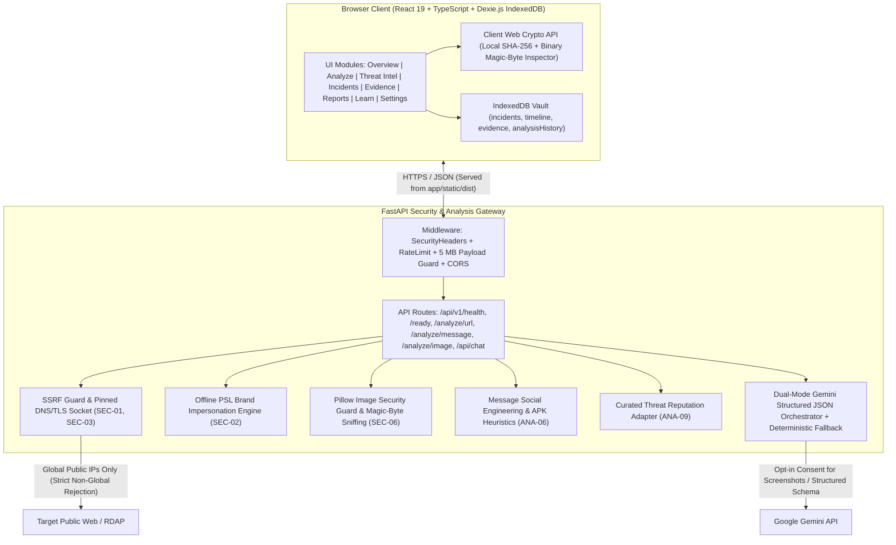

# Architecture Overview — SecurAI v2.5.0

SecurAI is a bilingual (Indonesian / English), Local-First **Digital Trust, Threat Intelligence, and Incident Assistance** platform built with a **FastAPI** backend and a **React 19 + TypeScript + Vite + Dexie.js** frontend.

---

## 1. High-Level System Architecture

---

## 2. Core Design Decisions & Boundaries

### Frontend (Local-First SPA)
- **Framework:** React 19, TypeScript (`tsc -b`), Vite (`vite build` outputs to `app/static/dist/`), Tailwind CSS v4, Lucide icons, and `oxlint`.
- **Dual User Mode (`ModeContext`):**
  - `consumer`: Plain-language explanations, safety action steps, bank dispute workflows, interactive phishing quiz.
  - `analyst`: Full technical network telemetry (resolved IP, redirect hops, TLS certificate issuer/expiry, RDAP age/registrar, rule findings, MITRE ATT&CK tags, canonical JSON export).
- **Local-First Storage (`frontend/src/db/index.ts`):** Dexie.js wrapper over browser IndexedDB (`securai_local_vault`) with deterministic canonical JSON export/import and SHA-256 package integrity sealing.
- **Zero-Upload Local File Analyzer (`frontend/src/utils/fileInspector.ts`):** Computes binary SHA-256 hashes and inspects magic bytes locally in the browser for `.apk`, `.pdf`, `.exe`, and masqueraded files.

### Backend (Defense-in-Depth Gateway)
- **Middleware (`app/core/middleware.py`):**
  - Security headers (`X-Content-Type-Options: nosniff`, `X-Frame-Options: DENY`, `Referrer-Policy`, `Permissions-Policy`, strict `Content-Security-Policy`).
  - Sliding-window in-memory rate limiter driven by `settings.RATE_LIMIT_PER_MINUTE` (`429` + `Retry-After`) and HTTP body ceiling (`5 MB`).
  - Configurable `ALLOWED_ORIGINS` CORS policy.
- **SSRF & Network Safety (`app/core/security.py`, `app/core/network_intel.py`):**
  - Strict scheme/port checks and userinfo rejection.
  - Full DNS `A`/`AAAA` resolution rejecting mixed public + non-global records (`RFC 1918`, loopback, link-local, CGNAT, IPv4-mapped IPv6, cloud IMDS).
  - Pinned-IP connections with original hostname SNI preservation, active TLS verification (`verify=True`), manual redirect inspection (<= 5 hops, SSRF re-check per hop), and 1 MB streaming body cap.
- **Screenshot & External AI Consent (`app/core/image_security.py`, `app/services/ai_service.py`):**
  - Strict base64 validation, magic-byte container verification (PNG/JPEG/WEBP), max decoded payload cap (`3 MB` default), and Pillow pixel/dimension caps (`4096x4096`) against decompression bombs.
  - Explicit opt-in `external_ai_consent` flag on `/api/v1/analyze/image`; skips external Gemini Vision when `False` while still returning verified metadata + 64-character SHA-256 manifest.
  - Respects configured `settings.MODEL_NAME` before fallback models (`settings.get_ordered_models()`).
- **Canonical Output Contract (`app/schemas.py`):** Every analyzer emits `CanonicalAnalysisResult` (`analysis_id`, `analysis_type`, `classification`, `risk_score`, `confidence`, `findings`, `mitre_techniques`, `recommended_actions`, `limitations`, `provider_status`).
