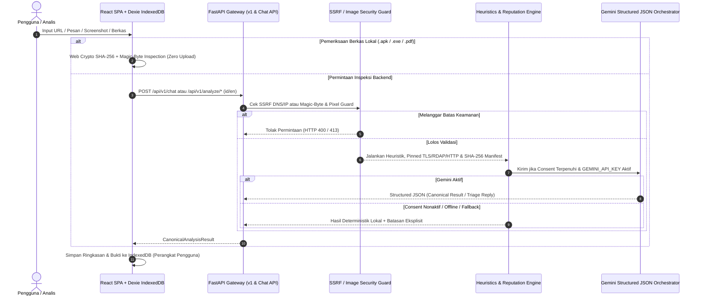
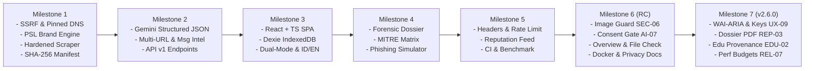

# 🛡️ SecurAI — Digital Trust, Threat Intelligence & Incident Assistance

<div align="center">

[](https://github.com/ChoqySirait)
[](https://www.python.org/)
[](https://fastapi.tiangolo.com/)
[](tests/)
[](frontend/)
[](LICENSE)
[](https://attack.mitre.org/)

<p align="center">
  <b>Platform asisten keamanan siber dan perlindungan konsumen digital berbasis <i>Dual-Engine</i> (Heuristik Asinkron Paralel + Multimodal AI Reasoning).</b><br>
  Dirancang untuk membedah rekayasa sosial perbankan, toko online palsu, berkas APK trojan, tangkapan layar penipuan, membedakan risiko <i>malvertising</i> pada situs komik non-resmi, serta mengamankan integritas bukti digital bagi korban penipuan finansial online.
</p>

[Pengembang](#-pengembang--arsitek) • [Status Implementasi](#-status-implementasi-fitur) • [Arsitektur Sistem](#-arsitektur--alur-data-sistem) • [Keamanan & Anti-SSRF](#-keamanan-jaringan--anti-ssrf) • [Instalasi & Docker](#-panduan-instalasi-pengujian--docker) • [Troubleshooting](#-troubleshooting)

</div>

---

## 👨‍💻 Pengembang / Arsitek

<div align="center">
  <table>
    <tr>
      <td align="center">
        <a href="https://github.com/ChoqySirait">
          <br />
          <sub><b>Choqy Pananda Sirait</b></sub>
        </a><br />
        <sub>Lead Developer & System Architect</sub><br /><br />
        <a href="https://github.com/ChoqySirait">
          
        </a>
      </td>
    </tr>
  </table>
  <p><i>Proyek ini dikembangkan secara bertahap dan defensif dengan standar rekayasa perangkat lunak dan arsitektur keamanan siber yang ketat.</i></p>
</div>

---

## 📊 Status Implementasi Fitur

### ✅ Fitur Rilis v2.6.0 (Milestones 1–7 Selesai)
- **Aksesibilitas Keyboard/ARIA, Cetak PDF Dosir & Performance Budgets (Milestone 7 - UX-09, REP-03, EDU-02, REL-07):** Navigasi tab WAI-ARIA (*skip-link*, `tablist`/`tab` panah keyboard, `aria-live`), cetak PDF dosir forensik bersih (`@media print`), sumber & tanggal peninjauan studi kasus, serta guard ukuran aset `dist` dan target latensi p95 luring.
- **Screenshot Security Hardening & Consent Gate (Milestone 6 - SEC-06, AI-07, UX-06):** Validasi ketat payload base64, deteksi *magic bytes* PNG/JPEG/WEBP, batas ukuran 3 MB & batas dimensi/piksel *decompression bomb* (4096×4096 via Pillow), segel SHA-256 64-karakter, serta endpoint `POST /api/v1/analyze/image` dengan gerbang **persetujuan eksplisit AI eksternal (`external_ai_consent`)**.
- **Local Overview Dashboard & Binary Inspector (Milestone 6 - UX-05, ANA-10):** Tab **Ringkasan / Overview** berbasis riwayat IndexedDB (`db.analysisHistory`) serta pemeriksa berkas biner lokal (`.apk`, `.pdf`, `.exe`, `.zip`) via browser Web Crypto API SHA-256 + deteksi penyamaran *magic-byte masquerading* 100% di klien tanpa mengunggah berkas ke server.
- **Containerized Deployment & Governance Docs (Milestone 6 - REL-04, GOV-01, GOV-02):** `Dockerfile` multi-stage (build React Vite + runtime Python non-root `appuser` + healthcheck), `docker-compose.yml` read-only rootfs, [`PRIVACY.md`](PRIVACY.md), dan pemberitahuan privasi & batas penggunaan sah di dalam aplikasi.
- **Defensive HTTP Security Headers, Rate Limiting & CORS (Milestone 5 - SEC-08, SEC-09):** Header `X-Content-Type-Options: nosniff`, `X-Frame-Options: DENY`, `Referrer-Policy`, `Permissions-Policy`, `Content-Security-Policy`, konfigurasi `ALLOWED_ORIGINS`, pembatas muatan 5 MB (HTTP 413), dan *sliding-window rate limiter* berbasis konfigurasi `RATE_LIMIT_PER_MINUTE` (default 120 req/menit, HTTP 429 + `Retry-After`).
- **Threat Intelligence & Benchmark Dataset (Milestone 5 - ANA-09, REL-01, REL-02):** `ThreatReputationAdapter` dengan *curated threat feed*, 7 skenario benchmark evaluasi, dan alur CI GitHub Actions (`.github/workflows/ci.yml`) yang menjalankan pytest offline, `oxlint`, `tsc -b`, dan Vite production build.
- **Forensic Incident Dossier, MITRE ATT&CK Matrix & Learning Center (Milestone 4):** Generator laporan dosir insiden `.md`/`.json`, matriks interaktif MITRE ATT&CK, dan simulator kuis deteksi phishing bilingual.
- **React 19 + Vite + TypeScript SPA & Dexie.js Local-First Vault (Milestone 3):** Antarmuka modern bilingual (ID/EN), Consumer vs Analyst SOC Mode, Buku Kasus Insiden, Kronologi Timeline, Surat Sanggahan Bank, dan Brankas Bukti SHA-256 lokal via IndexedDB (`securai_local_vault`).
- **Hardened Anti-SSRF, PSL Brand Impersonation & Scraper (Milestone 1 & 2 - SEC-01 s/d SEC-04, AI-01 s/d AI-06):** Validasi DNS A/AAAA ketat, penolakan IP privat/metadata/campuran, *pinned IP TLS/SNI*, redirect manual maksimal 5 hop, limit body 1 MB, engine Public Suffix List lokal, `MODEL_NAME` terkonfigurasi dengan Google GenAI Structured JSON + fallback deterministik lokal.

Untuk rincian arsitektur teknis dan batas pemrosesan data, lihat [`ARCHITECTURE.md`](ARCHITECTURE.md) dan [`PRIVACY.md`](PRIVACY.md).

---

## 🔬 Arsitektur & Alur Data Sistem



---

## 🛡️ Keamanan Jaringan & Anti-SSRF

SecurAI menerapkan prinsip *Defense-in-Depth* pada lapisan jaringan:
1. **DNS Pre-Validation:** Setiap hostname diuraikan seluruh record A dan AAAA-nya via `socket.getaddrinfo`.
2. **Rejection of Non-Global IPs:** Seluruh subnet privat RFC 1918, loopback (`127.0.0.0/8`, `::1`), link-local (`169.254.0.0/16`), IPv4-mapped IPv6, dan Cloud IMDS (`169.254.169.254`) ditolak seketika.
3. **Anti-DNS Rebinding (Pinned IP Connection):** Koneksi socket SSL diarahkan ke IP terverifikasi sambil mempertahankan `server_hostname` asli untuk validasi sertifikat TLS dan SNI.
4. **Manual Redirect Inspection:** Pengalihan ditelusuri secara manual maksimal 5 hop dengan validasi ulang SSRF pada setiap tujuan redirect.
5. **Bounded Payload & Image Guards:** Aliran HTTP dibatasi maksimal 1 MB, body request HTTP dibatasi maksimal 5 MB, dan payload gambar divalidasi ukuran, MIME, *magic bytes*, serta dimensi pikselnya (maks 4096×4096 px).

---

## 🛠️ Tech Stack & Dependensi

- **Frontend:** React 19, TypeScript, Vite, Tailwind CSS v4, Dexie.js (IndexedDB), Lucide Icons, Web Crypto API, `oxlint`
- **Backend Runtime:** Python 3.10+ (Diuji pada Python 3.13), FastAPI, Uvicorn, Pydantic v2
- **HTTP, Network & Security:** HTTPX (Streaming client), Pillow (Image verification), Python `ssl` & `socket`
- **AI Engine:** Google GenAI SDK (`gemini-3.5-flash` via `MODEL_NAME` dengan daftar model fallback) menggunakan Structured JSON Outputs
- **Testing & CI:** Pytest 9+, `pytest-asyncio`, GitHub Actions, Docker multi-stage build

---

## 🚀 Panduan Instalasi, Pengujian & Docker

### 1. Menjalankan Secara Lokal (Development & Production Build)
```bash
git clone https://github.com/ChoqySirait/Chatbot.git
cd Chatbot

# Buat dan aktifkan Python virtual environment
python -m venv .venv
# Windows PowerShell:
.\.venv\Scripts\Activate.ps1
# Linux / macOS:
# source .venv/bin/activate

# Pasang dependensi Python
pip install -r requirements.txt
pip install -r requirements-dev.txt

# Konfigurasi environment (.env opsional bila hanya menggunakan mode fallback lokal)
cp .env.example .env

# Bangun frontend produksi React -> app/static/dist/
npm --prefix frontend ci
npm --prefix frontend run lint
npm --prefix frontend run test
npm --prefix frontend run build

# Jalankan server FastAPI (menyajikan frontend + API di port 8000)
uvicorn app.main:app --host 127.0.0.1 --port 8000
```
Buka browser pada alamat: `http://127.0.0.1:8000`.

### 2. Menjalankan Automated Tests (Pytest + Vitest Offline) & Linter
```bash
pytest -v
npm --prefix frontend run lint
npm --prefix frontend run test
```
*Hasil aktual terakhir:* **86/86 test cases Pytest lulus 100% (offline dengan mocking deterministik)**, **9/9 unit test Vitest lulus**, serta **0 warnings / 0 errors** pada `oxlint`. Antarmuka menggunakan tema tunggal **Dark Slate** minimalis tanpa banner berulang agar kontras konsisten di seluruh modul (kecuali pratinjau cetak putih pada Surat Sanggahan Bank dan Dosir Forensik PDF).

### 3. Menjalankan dengan Docker / Docker Compose
Pastikan `.env` tersedia (salin dari `.env.example`), lalu bangun dan jalankan container produksi:
```bash
docker compose up --build -d
```
Container menjalankan aplikasi pada `http://127.0.0.1:8000` dengan user non-root (`appuser`), *read-only root filesystem*, dan pemeriksaan `/api/v1/health` otomatis.

---

## 🔧 Troubleshooting

- **Header menunjukkan status API `Offline` atau halaman lama yang muncul:**
  Pastikan server Uvicorn berjalan (`http://127.0.0.1:8000/api/v1/health` mengembalikan `{"status": "healthy"}`) dan jalankan `npm --prefix frontend run build` agar `app/static/dist/` selalu terbaru.
- **Layanan AI Vision / Chat berjalan pada mode Fallback Lokal:**
  Jika `GEMINI_API_KEY` tidak diatur pada `.env`, kuota habis, atau checkbox persetujuan AI eksternal pada tab **Screenshot** tidak dicentang, SecurAI secara sengaja menggunakan analisis heuristik lokal deterministik tanpa mengirim data ke Google Gemini API.
- **Error `413 Payload Too Large` saat mengunggah tangkapan layar:**
  Unggahan gambar dibatasi maksimal **3 MB** (biner mentah sebelum encoding base64) dalam batas wrapper HTTP **5 MB**, dan resolusi maksimum **4096×4096 piksel**.
- **Error `429 Too Many Requests`:**
  Sesuaikan `RATE_LIMIT_PER_MINUTE` pada `.env` jika sedang melakukan pengujian intensif di lingkungan lokal.

---

## 🗺️ Roadmap Pengembangan Bertahap



---

## 📄 Lisensi, Rilis, Privasi & Disclaimer

- **Catatan Rilis:** Lihat [`CHANGELOG.md`](CHANGELOG.md) untuk riwayat lengkap rilis `v2.6.0`.
- **Kebijakan Privasi & Penggunaan Sah:** Lihat [`PRIVACY.md`](PRIVACY.md).
- **Lisensi:** Dilindungi di bawah [`MIT License`](LICENSE).
- **Disclaimer Keamanan:** Segel kriptografis SHA-256 menjamin integritas data sejak artefak direkam (*tamper-evident*), sedangkan skor risiko heuristik dan analisis AI bersifat asistensi triage teknis—bukan jaminan mutlak atau bukti hukum tanpa validasi otoritas berwenang.
