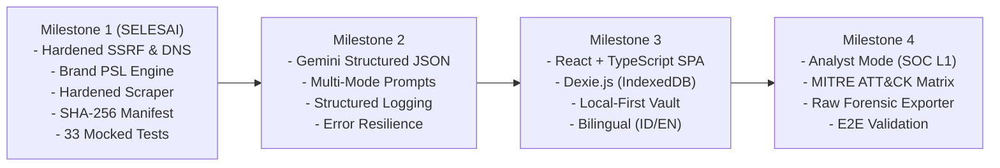

# 🛡️ SecurAI — Digital Trust, Threat Intelligence & Incident Assistance

<div align="center">

[](https://github.com/ChoqySirait)
[](https://www.python.org/)
[](https://fastapi.tiangolo.com/)
[](tests/)
[](https://attack.mitre.org/)
[](LICENSE)

<p align="center">
  <b>Platform asisten keamanan siber dan perlindungan konsumen digital berbasis <i>Dual-Engine</i> (Heuristik Asinkron Paralel + Multimodal AI Reasoning).</b><br>
  Dirancang untuk membedah rekayasa sosial perbankan, toko online palsu, berkas APK trojan, membedakan risiko <i>malvertising</i> pada situs komik non-resmi, serta mengamankan integritas bukti digital bagi korban penipuan finansial online di Indonesia.
</p>

[Pengembang](#-pengembang--arsitek) • [Status Implementasi](#-status-implementasi-fitur) • [Arsitektur Sistem](#-arsitektur--alur-data-sistem) • [Keamanan & Anti-SSRF](#-keamanan-jaringan--anti-ssrf) • [Instalasi & Pengujian](#-panduan-instalasi--pengujian) • [Roadmap Milestone](#-roadmap-pengembangan-bertahap)

</div>

---

## 👨‍💻 Pengembang / Arsitek

<div align="center">
  <table>
    <tr>
      <td align="center">
        <a href="https://github.com/ChoqySirait">
          <br />
          <sub><b>Choqy Pananda Sirait</b></sub>
        </a><br />
        <sub>Lead Developer & System Architect</sub><br /><br />
        <a href="https://github.com/ChoqySirait">
          
        </a>
      </td>
    </tr>
  </table>
  <p><i>Proyek ini dikembangkan secara bertahap dan defensif dengan standar rekayasa perangkat lunak dan arsitektur keamanan siber yang ketat.</i></p>
</div>

---

## 📊 Status Implementasi Fitur

Berdasarkan hasil baseline audit dan penyelesaian **Milestone 1 (Secure Foundation & Backend Reliability)**:

### ✅ Fitur yang Sudah Aktif & Teruji (Milestone 1)
- **Hardened Anti-SSRF Guard (SEC-01):** Validasi skema (`http/https`), resolusi lengkap DNS (A/AAAA), penolakan mutlak IP privat (RFC 1918), loopback, link-local, carrier-grade NAT, IPv4-mapped IPv6, dan cloud metadata (`169.254.169.254`). Rejeksi total pada domain DNS campuran (*mixed public/private records*).
- **Brand Impersonation & Typosquatting Engine (SEC-02):** Ekstraksi domain berbasis *Public Suffix List* (PSL) lokal (offline, zero-network). Membedakan secara akurat antara domain resmi merek (BCA, Tokopedia, Shopee, Mandiri, BRI, BNI, Dana, GoPay, OVO, Blibli, WhatsApp) dan domain tiruan, menghilangkan *false positive* pada domain resmi (`bca.co.id`, `tokopedia.com`).
- **Hardened Web Content Scraper (SEC-03):** Pengambilan sampel web dengan verifikasi TLS aktif (`verify=True`), penanganan pengalihan manual (*manual redirect tracking*) maksimal 5 hop dengan validasi ulang SSRF pada setiap hop, pembatasan body respons streaming maksimal 1 MB, dan koneksi socket aman dengan preservasi SNI.
- **Cryptographic Evidence Manifest (SEC-04):** Pembuatan segel bukti digital SHA-256 64-karakter heksadesimal penuh dilengkapi manifest kanonikal deterministik (identitas artefak, MIME, ukuran, timestamp UTC ISO 8601, dan raw SHA-256).
- **Konsistensi Telemetri Respons (ENG-02):** Backend konsisten mengembalikan data telemetri teknis (SSL, umur domain, judul halaman) meskipun skor risiko bernilai nol pada domain resmi yang aman.
- **Automated URL Defanging:** Menetralkan tautan mencurigakan (`hxxps[://]domain[.]com`).
- **Reproducible Test Environment (ENG-01):** 33 unit dan security tests terisolasi dengan 100% *deterministic mocks* (DNS, socket, HTTP, SSL), berjalan dalam ~2 detik secara offline.

### ⏳ Fitur dalam Roadmap (Belum Aktif)
- **Milestone 2:** Gemini Structured JSON Output (kontrak skema Pydantic ketat), prompt adaptif terpisah untuk Konsumen dan Analis, serta logging error terstruktur.
- **Milestone 3:** Migrasi antarmuka ke React + Vite + TypeScript, penyimpanan lokal *Local-First* via Dexie.js (IndexedDB), dan dukungan bilingual dinamis (Bahasa Indonesia & English).
- **Milestone 4:** Konsol Khusus **Analyst Mode (SOC L1 Triage)**, visualisasi matriks MITRE ATT&CK interaktif, inspeksi raw header HTTP, serta ekspor laporan forensik komprehensif (JSON/Markdown).

---

## 🔬 Arsitektur & Alur Data Sistem

SecurAI memadukan evaluasi heuristik lokal deterministik dan penalaran kognitif AI dalam arsitektur bertahap:

```mermaid
sequenceDiagram
    autonumber
    actor User as Pengguna / Analis
    participant UI as Antarmuka Konsol
    participant GW as FastAPI Gateway
    participant SEC as SSRF & Safe DNS Guard
    participant Core as Parallel Telemetry Engine (asyncio)
    participant AI as AI Cognitive Service (Gemini)

    User->>UI: Input Tautan / Pesan / Screenshot
    UI->>GW: POST /api/chat (JSON Payload)
    
    rect rgb(11, 25, 44)
        Note over GW,SEC: Tahap 1: Validasi Keamanan Input & Anti-SSRF
        GW->>SEC: Validasi Skema, Hostname & Resolusi DNS
        alt DNS Menghasilkan IP Privat / Non-Global
            SEC-->>GW: Tolak Permintaan (SSRF Violation)
        else Seluruh Alamat IP Global & Aman
            SEC-->>Core: Jalankan Inspeksi Paralel (Pinned Safe IP)
            par Inspeksi TLS / SSL Handshake
                Core->>Core: Socket connect ke Pinned IP (SNI Hostname Asli)
            and Kueri Registrasi RDAP
                Core->>Core: Kueri ICANN RDAP secara Aman
            and HTTP Scraper Terkendali
                Core->>Core: GET (verify=True, max 1MB stream, manual redirects)
            end
            Core->>Core: Evaluasi Typosquatting (PSL) & Cetak SHA-256 Manifest
        end
    end

    Core->>AI: Kirim Konteks Chat + Telemetri Jaringan
    AI-->>GW: Respon Analisis & Kategori Ancaman
    GW-->>UI: Respons Lengkap (Balasan + Telemetri Jaringan)
    UI-->>User: Tampilkan Indikator Risiko & Telemetri Forensik
```



---

## 🛡️ Keamanan Jaringan & Anti-SSRF

SecurAI menerapkan prinsip *Defense-in-Depth* pada lapisan jaringan:
1. **DNS Pre-Validation:** Setiap hostname diuraikan seluruh record A dan AAAA-nya via `socket.getaddrinfo`.
2. **Rejection of Non-Global IPs:** Seluruh subnet privat RFC 1918, loopback (`127.0.0.0/8`, `::1`), link-local (`169.254.0.0/16`), IPv4-mapped IPv6, dan Cloud IMDS (`169.254.169.254`) ditolak seketika.
3. **Anti-DNS Rebinding (Pinned IP Connection):** Koneksi socket SSL diarahkan secara spesifik ke alamat IP yang telah divalidasi, dengan parameter `server_hostname` tetap menggunakan nama domain asli untuk menjamin validitas sertifikat TLS dan pengiriman SNI.
4. **Manual Redirect Inspection:** Scraper tidak mengizinkan redirect otomatis tak terkontrol. Setiap hop diperiksa ulang dengan validator SSRF sebelum koneksi baru dibuat (maksimal 5 hop).
5. **Ukuran Respons Dibatasi:** Aliran stream dipotong maksimal 1 MB untuk mencegah eksploitasi kehabisan memori (*denial of service*).

---

## 🛠️ Tech Stack & Dependensi

- **Backend Runtime:** Python 3.10+ (Diuji pada Python 3.13)
- **Web Framework:** FastAPI, Uvicorn (Asynchronous ASGI)
- **HTTP & Network Engine:** HTTPX (Streaming client), Python Native `ssl` & `socket`
- **Data Validation:** Pydantic v2
- **Suffix & Brand Engine:** Custom Local Public Suffix List (PSL) Engine
- **Frontend Saat Ini (Baseline):** HTML5, Tailwind CSS, Vanilla JS (ES6+)
- **Testing Framework:** Pytest 9+, `pytest-asyncio`

---

## 🚀 Panduan Instalasi & Pengujian

### 1. Kloning Repositori
```bash
git clone https://github.com/ChoqySirait/Chatbot.git
cd Chatbot
```

### 2. Konfigurasi Virtual Environment
```bash
# Membuat virtual environment terisolasi
python -m venv .venv

# Aktivasi virtual environment
# Windows (PowerShell):
.\.venv\Scripts\Activate.ps1
# Linux / macOS:
source .venv/bin/activate
```

### 3. Instalasi Dependensi
```bash
# Instalasi runtime dependencies
pip install -r requirements.txt

# Instalasi dependencies pengembangan & testing
pip install -r requirements-dev.txt
```

### 4. Konfigurasi Environment Variables
Salin berkas template environment:
```bash
cp .env.example .env
```
Isi konfigurasi pada berkas `.env`:
```ini
GEMINI_API_KEY=your_gemini_api_key_here
```

### 5. Menjalankan Automated Tests (Pytest)
Seluruh pengujian dirancang 100% offline dengan mocking deterministik:
```bash
pytest -v
```
*Hasil aktual:* 33 test cases lulus 100% dalam < 2 detik.

### 6. Menjalankan Backend Server
```bash
uvicorn app.main:app --reload --host 127.0.0.1 --port 8000
```
Buka browser pada alamat: `http://127.0.0.1:8000`

---

## 🗺️ Roadmap Pengembangan Bertahap



---

## 📄 Lisensi & Disclaimer
Proyek ini dilisensikan di bawah [MIT License](LICENSE).  
*Disclaimer Keamanan:* Segel kriptografis SHA-256 menjamin integritas data (tamper-evident), namun tidak secara mandiri menjamin keabsahan hukum atau kebenaran kejadian tanpa validasi forensik resmi oleh pihak berwenang.
