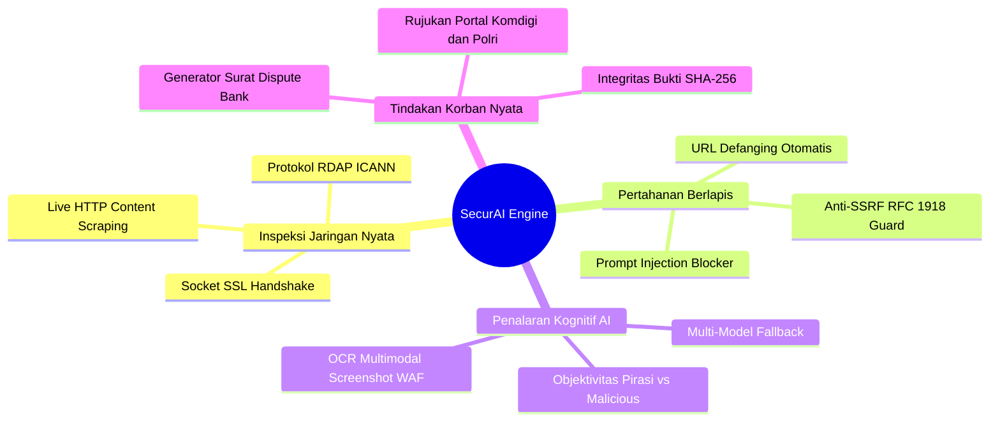

# 🛡️ SecurAI ConsumerGuard — Digital Anti-Fraud & Live Threat Telemetry Hub

<div align="center">


[](https://github.com/ChoqySirait)
[](https://www.python.org/)
[](https://fastapi.tiangolo.com/)
[](https://ai.google.dev/)
[](https://tailwindcss.com/)
[](tests/)
[](https://attack.mitre.org/)
[](LICENSE)

<p align="center">
  <b>Platform perlindungan konsumen digital cerdas berbasis <i>Dual-Engine</i> (Heuristik Asinkron Paralel + Multimodal AI Reasoning).</b><br>
  Dirancang khusus untuk membedah rekayasa sosial perbankan, toko online palsu, file APK trojan, membedakan risiko <i>malvertising</i> pada situs komik non-resmi, serta mengamankan bukti digital bagi korban penipuan finansial online di Indonesia.
</p>

[Pengembang](#-pengembang--kontak) • [Fitur Utama](#-fitur-unggulan) • [Arsitektur & Alur](#-arsitektur--alur-data-sistem) • [PRD & Spesifikasi](#-product-requirement-document-prd) • [Instalasi](#-panduan-instalasi--menjalankan-sistem) • [Matriks MITRE](#-pemetaan-mitre-attck--klasifikasi) • [Struktur Proyek](#-struktur-direktori)

</div>

---

## 👨‍💻 Pengembang / Creator

<div align="center">
  <table>
    <tr>
      <td align="center">
        <a href="https://github.com/ChoqySirait">
          <br />
          <sub><b>Choqy Pananda Sirait</b></sub>
        </a><br />
        <sub>Lead Developer & System Architect</sub><br /><br />
        <a href="https://github.com/ChoqySirait">
          
        </a>
      </td>
    </tr>
  </table>
  <p><i>Proyek ini dirancang dan dikembangkan sebagai solusi operasional perlindungan konsumen digital, mitigasi insiden siber, dan rekayasa perangkat lunak berstandar industri.</i></p>
</div>

---

## 📱 Antarmuka Aplikasi (Desktop & Mobile)

<div align="center">
  <table>
    <tr>
      <td width="65%" align="center">
        <b>🖥️️ Tampilan Desktop (Split-Pane Live Telemetry)</b><br><br>
       
      
      </td>
      <td width="35%" align="center">
        <b>📱 Tampilan Mobile (Tab Switcher)</b><br><br>
        
      </td>
    </tr>
  </table>
  <sub><i>Tampilan Desktop dan Mobile</i></sub>
</div>

---

## ⚡ Mengapa SecurAI ConsumerGuard Berbeda?

Sebagian besar chatbot keamanan hanya bertindak sebagai *wrapper prompt* biasa yang menebak bahaya semata-mata dari nama domain. **SecurAI mengintegrasikan protokol forensik jaringan nyata tanpa asumsi kosong:**



## 🔬 Arsitektur & Alur Data Sistem
SecurAI memanfaatkan arsitektur Asynchronous Parallel Telemetry (asyncio.gather). Ketika pengguna mengirimkan tautan, sistem tidak mengeksekusi inspeksi secara sekuensial yang lambat, melainkan melakukan handshake SSL, kueri database registrasi domain RDAP, dan scraping konten secara simultan.

```mermaid
sequenceDiagram
    autonumber
    actor User as Pengguna / Korban
    participant UI as Dual-Pane Cockpit (Web/Mobile)
    participant GW as FastAPI Gateway (Anti-SSRF & Sanitizer)
    participant Core as Parallel Telemetry Engine (asyncio)
    participant AI as Google Gemini 3.1 Flash-Lite (w/ Fallback)

    User->>UI: Input Tautan / Pesan Rekayasa Sosial / Screenshot
    UI->>GW: HTTP POST /api/chat (JSON Payload + History)
    
    rect rgb(11, 25, 44)
        Note over GW: Validasi Anti-SSRF (Tolak Localhost & IP RFC 1918)<br/>Penyaringan Injeksi Prompt
        GW->>Core: Jalankan Eksekusi Forensik Paralel
        par Inspeksi Sertifikat SSL
            Core->>Core: Direct Socket Handshake Port 443 (Issuer & Expiry)
        and Kueri Registrasi RDAP
            Core->>Core: Fetch ICANN RDAP (Hitung Usia Domain Nyata)
        and HTTP Headless Inspection
            Core->>Core: Ekstraksi Title, Meta, & Kata Kunci Ancaman
        end
        Core->>Core: Kalkulasi Skor Heuristik & Cetak SHA-256 Evidence Seal
    end

    Core->>AI: Kirim Konteks Chat + Telemetri Teknis Jaringan
    
    alt Model Utama Tersedia
        AI-->>GW: Respons Rekomendasi Solutif + Tag MITRE
    else Server Utama Mengalami Lonjakan Trafik (503/429)
        AI->>AI: Otomatis Alihkan ke Model Cadangan (Multi-Model Fallback)
        AI-->>GW: Respons Terjaga Tanpa Crash
    end

    GW-->>UI: JSON Payload (Balasan Luwes + Data Telemetri Panel Kanan)
    UI-->>User: Tampilkan Indikator Risiko, Kartu Forensik, & Surat Dispute 
```


---

## 📋 Product Requirement Document (PRD)
### 1. Latar Belakang & Pernyataan Masalah
   - Tingginya angka kerugian masyarakat akibat penipuan transaksi digital, tautan phishing APK kurir/undangan, dan toko online palsu di Indonesia.
   - Sebagian besar korban mengalami kepanikan pada 15 menit pertama (Golden Hour) dan tidak tahu format data apa yang harus diserahkan kepada pihak perbankan guna menahan saldo penipu.
   - Banyak sistem filter otomatis memukul rata seluruh web ilegal komik/streaming sebagai pencuri data, sehingga rekomendasi mitigasi yang diberikan kepada pengguna awam menjadi bias dan tidak edukatif.

### 2. Sasaran Pengguna
   - Masyarakat Konsumen Digital: Membutuhkan validasi cepat sebelum mentransfer uang ke penjual online atau mengklik tautan promo.
   - Korban Penipuan Siber: Membutuhkan panduan darurat taktis dan draf kronologi resmi untuk pemblokiran rekening tujuan.
   - Analis Keamanan Junior (L1 SOC) / Mahasiswa: Menggunakan konsol untuk membedah tautan mencurigakan dengan parameter defanging dan ekstraksi metadata.

---

### 3. Matriks Kebutuhan Fungsional (Functional Requirements)

| Kode | Modul | Kebutuhan Sistem | Kriteria Keberhasilan |
| :--- | :--- | :--- | :--- |
| **FR-01** | *Safe URL Engine* | Validasi anti-SSRF terhadap seluruh masukan URL. | Menolak resolusi alamat `127.0.0.1`, `localhost`, dan subnet privat RFC 1918. |
| **FR-02** | *Parallel Inspector* | Memeriksa SSL, RDAP, dan konten web secara asinkron. | Total latensi inspeksi teknis jaringan ≤ 1.8 detik per request. |
| **FR-03** | *Multimodal Fallback* | Menerima lampiran gambar jika web target dilindungi WAF. | AI Vision membaca elemen formulir sensitif atau logo tiruan dari screenshot. |
| **FR-04** | *Adaptive Tone* | Merespons percakapan nonformal (*"min"*, *"bro"*, *"ini nipu ga?"*). | Menghasilkan jawaban yang empatik, solutif, dan tanpa salam pembuka klise. |
| **FR-05** | *Evidence Hashing* | Menghasilkan segel integritas digital instan. | Dihasilkan hash SHA-256 16-karakter unik untuk setiap sesi pemeriksaan. |
| **FR-06** | *Dispute Automation* | Generator surat permohonan blokir rekening bank penipu. | Menghasilkan berkas teks terstruktur siap bawa dalam 1 kali klik. |

### 4. Batasan Teknis & Keamanan (Non-Functional Requirements)
  - Kerahasiaan Data: Aplikasi bersifat stateless; riwayat percakapan hanya disimpan di memori klien (browser) dan tidak disimpan permanen di database server demi privasi pengguna.
  - Resiliensi API: Memiliki daftar Multi-Model Fallback (gemini-3.1-flash-lite $\rightarrow$ gemini-3.5-flash $\rightarrow$ gemini-3.8-flash) untuk menangani lonjakan antrean server pihak ketiga.

## 🛠️ Tech Stack & Dependensi
  - Backend Framework: FastAPI (Asynchronous Python Web Framework)
  - Server Gateway: Uvicorn (Lightning-fast ASGI Server)
  - AI Cognitive Core: Google GenAI SDK (gemini-3.1-flash-lite & fallback cluster)
  - Network & HTTP Layer: HTTPX (Async HTTP client) & Python Native ssl/socket
  - Data Validation: Pydantic v2
  - Frontend UI: Vanilla JS (ES6+), HTML5, Tailwind CSS CDN, FontAwesome 6
  - Automated Testing: Pytest & asyncio test runner

```Soon```
